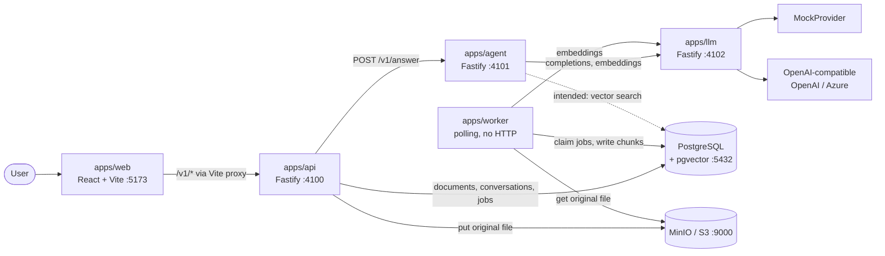

# Agents Platform Documentation

A TypeScript pnpm monorepo prototype of a multi-tenant, document-grounded Q&A platform (RAG). Users upload documents, a background worker extracts/chunks/embeds them into pgvector, and an agent service answers questions with citations.

### System topology

| Document | Contents |
| --- | --- |
| [diagrams.md](diagrams.md) | 22 Mermaid diagrams: topology, sequences, state machines, ER, class and flow diagrams |
| [architecture.md](architecture.md) | System overview, service topology, request and ingestion flows |
| [services.md](services.md) | Per-app and per-package reference (`apps/*`, `packages/*`) |
| [api-reference.md](api-reference.md) | HTTP endpoints of the API, agent, and LLM gateway |
| [data-model.md](data-model.md) | PostgreSQL schema, tenant isolation, object storage, vector index |
| [configuration.md](configuration.md) | Environment variables, ports, provider selection |
| [development.md](development.md) | Setup, commands, testing, conventions, extending the platform |
| [known-gaps.md](known-gaps.md) | Prototype limitations and inconsistencies found while documenting |
| [superpowers/](superpowers/) | Original design spec and implementation plan (2026-10-15) |

Also see the root `README.md` (quick start) and `AGENTS.md` (repository guidelines).
