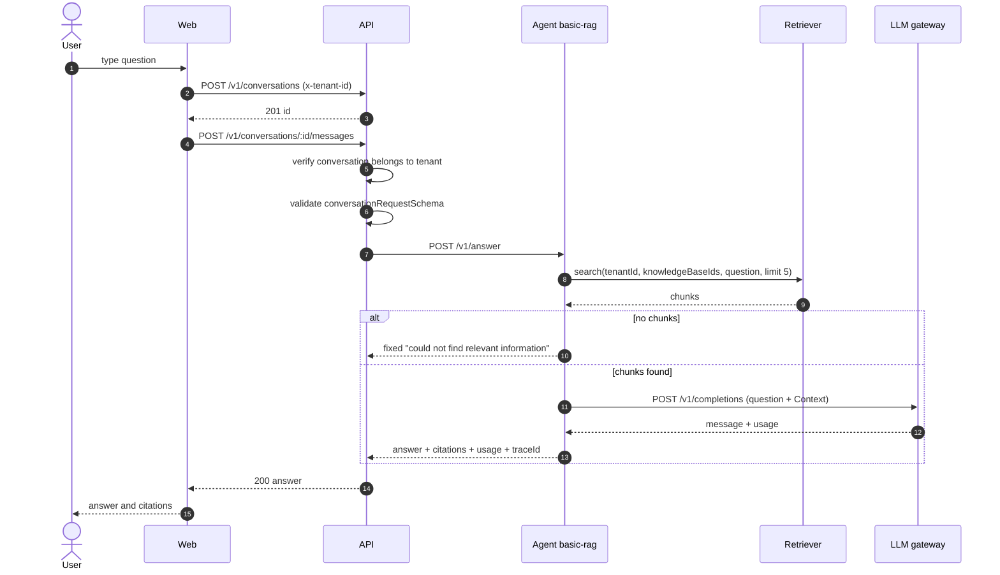
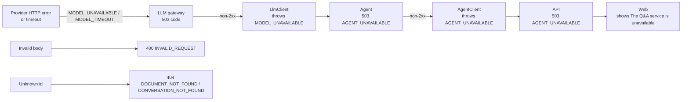

# HTTP API Reference

All services expose `GET /health` → `{ "ok": true }`. Bodies are JSON.

## Public API (`apps/api`, :4100)

Tenant selection: header `x-tenant-id` (dev only; falls back to `TENANT_ID`, then `local`).

| Method & path | Description | Success | Errors |
| --- | --- | --- | --- |
| `GET /v1/documents` | List the tenant's documents | `200` array of documents | – |
| `GET /v1/documents/:id` | Get one document | `200` document | `404 {code:"DOCUMENT_NOT_FOUND"}` |
| `DELETE /v1/documents/:id` | Delete a document, its stored file, chunks, embeddings and ingestion jobs | `204` | `404 {code:"DOCUMENT_NOT_FOUND"}` |
| `GET /v1/documents/:id/chunks` | Inspect a document: text re-extracted from the stored file plus the stored chunks the agent searches | `200` inspection | `404 {code:"DOCUMENT_NOT_FOUND"}` |
| `POST /v1/documents` | Register (and optionally upload) a document | `201` document | `400 {code:"INVALID_REQUEST"}` if no `filename` |
| `POST /v1/conversations` | Create a conversation | `201 {id, tenantId, createdAt}` | – |
| `POST /v1/conversations/:id/messages` | Ask a question in a conversation | `200 {conversationId, answer, citations, toolCalls, usage?, traceId}` | `404 CONVERSATION_NOT_FOUND`, `400 INVALID_REQUEST` (+`issues`), `503 AGENT_UNAVAILABLE` |

`POST /v1/documents` body: `{ filename: string, contentType?: string (default "text/plain"), sizeBytes?: number, contentBase64?: string }`.
Document shape: `{ id, tenantId, knowledgeBaseId ("default"), filename, contentType, sizeBytes, status: pending|processing|ready|failed, createdAt }`.

Inspection shape: `{ document, extractedText (null if extraction failed), extractionError?, chunkOptions: { maxCharacters, overlapCharacters }, chunks: [{ id, ordinal, text, startOffset, endOffset }] }`. The text is re-extracted on demand, and offsets are recovered by re-chunking it with the ingestion chunker; they are `null` when a stored chunk no longer matches that output.

`POST …/messages` body: `{ message: string, knowledgeBaseIds?: string[], traceId?: string }`.
Citation: `{ documentId, filename, chunkId, text, page?, score? }`.

Example:

```bash
curl -X POST localhost:4100/v1/conversations -H 'x-tenant-id: local'
curl -X POST localhost:4100/v1/conversations/<id>/messages \
  -H 'x-tenant-id: local' -H 'content-type: application/json' \
  -d '{"message":"What is the refund policy?","knowledgeBaseIds":["default"]}'
```


### Question answering sequence



## Agent service (`apps/agent`, :4101)

`POST /v1/answer` — body per `agentRequestSchema` (`tenantId`, `knowledgeBaseIds`, `conversationId`, `messages`, `question`, `options?`, `traceId?`); returns `agentResponseSchema` (`answer`, `citations`, `toolCalls`, `usage?`, `traceId`). Errors: `400 INVALID_REQUEST`, `503 AGENT_UNAVAILABLE`.

## LLM gateway (`apps/llm`, :4102)

| Endpoint | Body → Response |
| --- | --- |
| `POST /v1/completions` | `completionRequestSchema` (`model`, `messages`, `temperature?`, `maxTokens?`, `responseFormat?`) → `{model, message, finishReason, usage}` |
| `POST /v1/embeddings` | `{model, input: string \| string[]}` → `{model, embeddings: number[][], usage?}` |
| `GET /v1/models` | → `ModelDescriptor[]` (`id`, `provider`, `capabilities`, `contextWindow?`) |

Errors: `503 {code:"MODEL_UNAVAILABLE" | "MODEL_TIMEOUT"}`.

## Error codes

`packages/contracts/src/errors.ts` defines the intended normalized envelope `{ error: { code, message, traceId? } }` with codes `VALIDATION_ERROR, UNAUTHORIZED, FORBIDDEN, NOT_FOUND, TENANT_NOT_FOUND, DOCUMENT_UNSUPPORTED, INGESTION_FAILED, MODEL_UNAVAILABLE, RETRIEVAL_FAILED, INTERNAL_ERROR`. The services currently return a flat `{ code }` body with their own code names (see above).


### Error propagation



## Streaming contracts

`agentEventSchema` (`text_delta`, `citation`, `done`) and `completionEventSchema` (`text_delta`, `done`) exist in `packages/contracts`, but no streaming endpoint is implemented.
