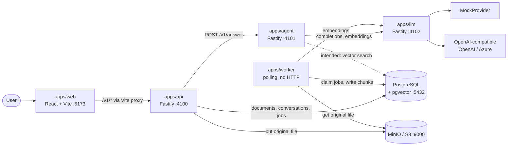
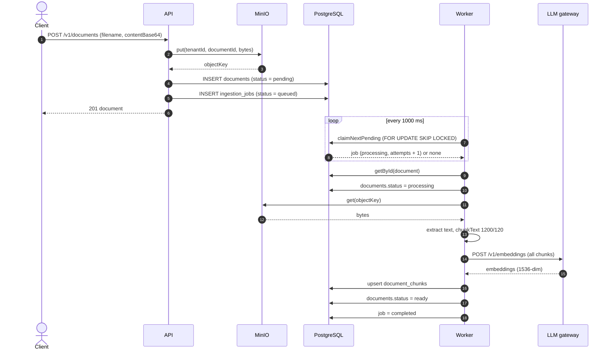
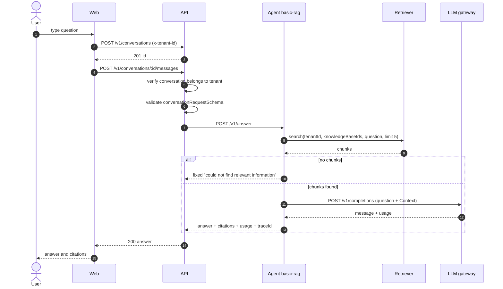
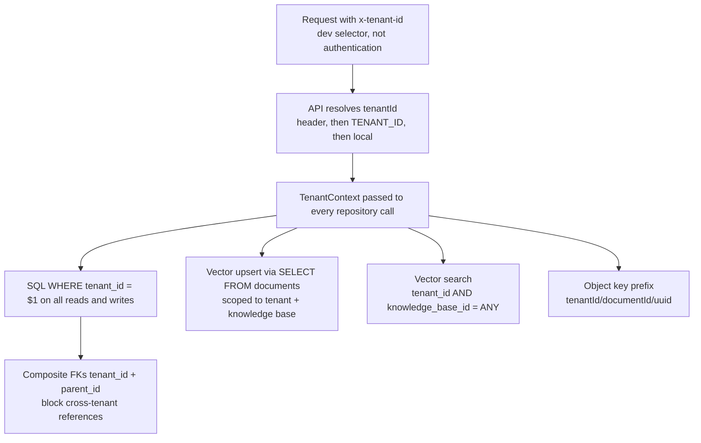

# Architecture

## Topology

Services are separate Node processes that communicate over HTTP using typed clients (`packages/clients`) and Zod contracts (`packages/contracts`). Docker Compose only starts the infrastructure (PostgreSQL/pgvector, MinIO); the app services are run manually.

## Design principles

- **Replaceability.** Agent runtimes (`AGENT_RUNTIME`, registry in `apps/agent`) and LLM providers (`LLM_PROVIDER`, registry in `apps/llm`) are chosen behind service boundaries, so neither the web app nor the public API changes when they are swapped. Shipped: runtime `basic-rag`; providers `mock`, `openai`, `azure-openai`.
- **Ports and adapters.** `packages/domain` defines ports (`DocumentRepository`, `ConversationRepository`, `JobRepository`, `VectorStore`, `ObjectStore`) with PostgreSQL/pgvector/MinIO adapters. Apps depend on the interfaces and receive implementations by constructor injection, which keeps unit tests free of network calls.
- **Explicit tenancy.** Every repository method takes a `TenantContext { tenantId }` (or a `tenantId` argument) and every tenant-owned table carries `tenant_id` with composite foreign keys.

## Flows

### Document ingestion

1. `POST /v1/documents` (API) — body carries filename, content type, optional base64 content.
2. With persistence enabled, the API stores the bytes in MinIO (`ObjectStore.put`), inserts a `documents` row (`status = pending`) and an `ingestion_jobs` row (`status = queued`).
3. The worker polls `claimNextPending()` (`UPDATE … FOR UPDATE SKIP LOCKED`), marking the job `processing` and incrementing `attempts`.
4. `processClaimedJob`: load document → pick an extractor by MIME type (`text/plain`, `application/pdf`, DOCX) → set document `processing` → fetch object → extract text → `chunkText` (1200 chars, 120 overlap) → embed all chunks via the LLM gateway → `upsertChunks` into `document_chunks` → document `ready`, job `completed`.
5. Any error sets document `failed` and job `failed` with `CODE: message` (`DOCUMENT_UNSUPPORTED` or `INGESTION_FAILED`).

**Ingestion sequence**

### Question answering

1. Web: `POST /v1/conversations`, then `POST /v1/conversations/:id/messages` with `{ message, knowledgeBaseIds }`, header `x-tenant-id`.
2. API verifies the conversation belongs to the tenant, validates with `conversationRequestSchema`, calls the agent (`POST /v1/answer`).
3. `BasicRagRuntime`: retrieve top 5 chunks → if none, return a fixed "could not find relevant information" answer → otherwise build a prompt `question + Context:` with `[chunkId] content` lines → LLM completion → return answer, citations (one per chunk), usage, `traceId`.
4. `VectorRetriever` (the intended retrieval adapter) embeds the query via the LLM gateway and calls `PgVectorStore.search` (cosine distance, tenant + knowledge-base filtered). **See [known-gaps.md](known-gaps.md): the agent entrypoint currently wires a stub that returns no chunks.**

**Question answering sequence**

## Tenant isolation

- API resolves tenant from the `x-tenant-id` header (fallback `TENANT_ID` env, then `local`). This is a **development selector, not authentication**.
- All repository SQL filters on `tenant_id`; cross-tenant references are prevented by composite FKs such as `(tenant_id, knowledge_base_id) → knowledge_bases(tenant_id, id)`.
- `PgVectorStore.upsertChunks` inserts via `SELECT … FROM documents WHERE tenant_id/knowledge_base_id/id`, so a chunk cannot be written outside its owning document's tenant and knowledge base.
- Vector search always includes `tenant_id = $1 AND knowledge_base_id = ANY($2)`.

### Isolation layers

