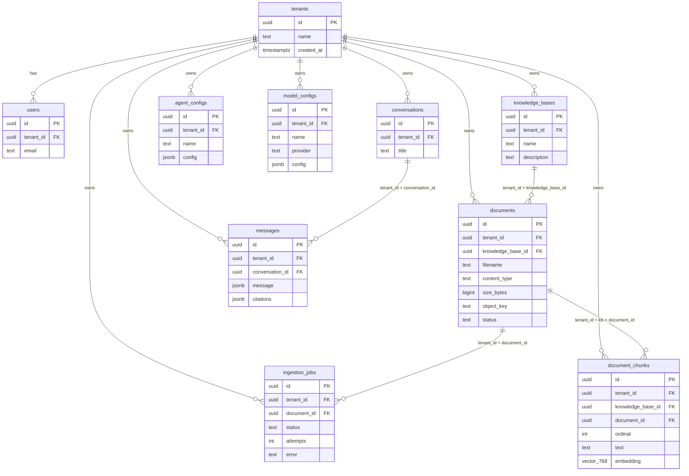
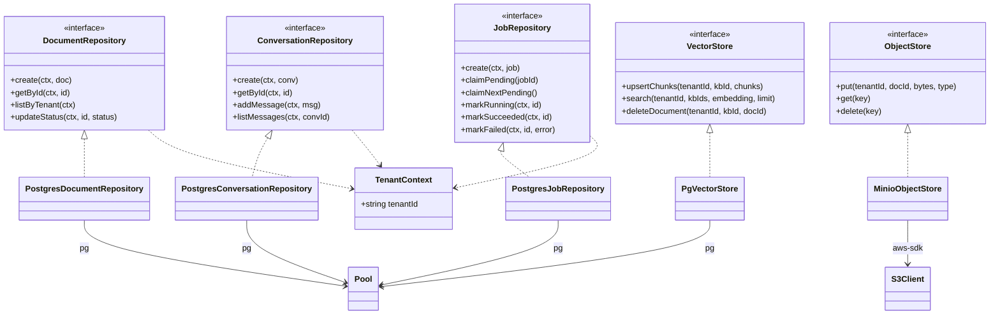
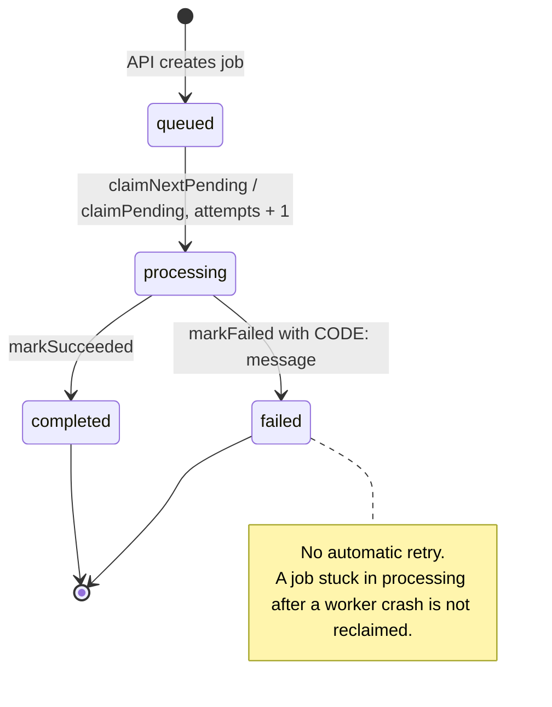
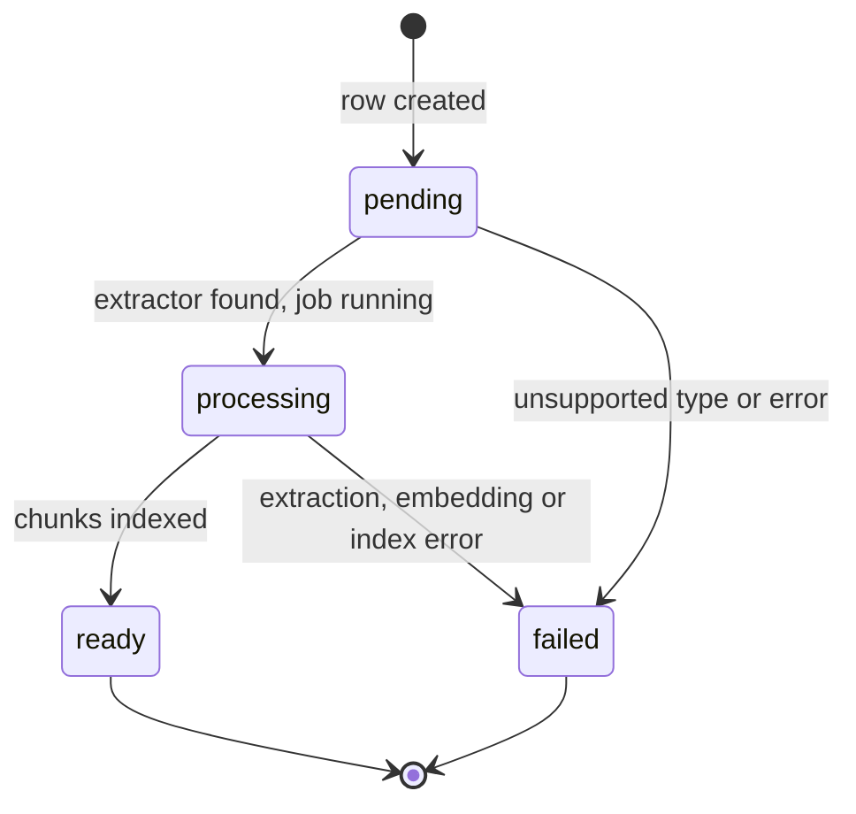
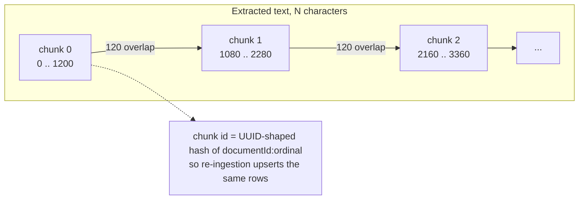
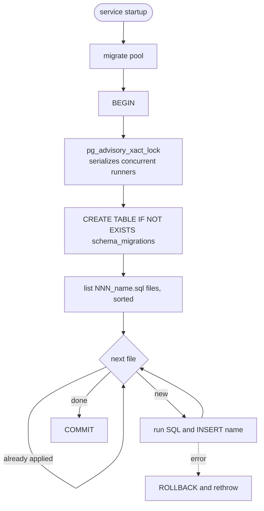

# Data Model

Migrations live in `packages/domain/src/migrations` and run automatically at API and worker startup.

## Tables (`001_initial.sql`, `002_vector.sql`, `003_embedding_768.sql`)

| Table | Key columns | Notes |
| --- | --- | --- |
| `tenants` | `id uuid`, `name` | Root of ownership; all others cascade-delete from it |
| `users` | `tenant_id`, `email` | Unique `(tenant_id, email)`; not yet used by code |
| `knowledge_bases` | `tenant_id`, `name`, `description` | `UNIQUE (tenant_id, id)` |
| `documents` | `tenant_id`, `knowledge_base_id`, `filename`, `content_type`, `size_bytes`, `object_key`, `status` | status ∈ pending/processing/ready/failed; composite FK to knowledge base |
| `conversations` | `tenant_id`, `title` | |
| `messages` | `tenant_id`, `conversation_id`, `message jsonb`, `citations jsonb` | Ordered by `(created_at, id)` |
| `agent_configs`, `model_configs` | `tenant_id`, `name`, `config jsonb` | Reserved; not yet used by code |
| `ingestion_jobs` | `tenant_id`, `document_id`, `status`, `attempts`, `error` | status ∈ queued/processing/completed/failed; partial index on queued jobs |
| `document_chunks` | `tenant_id`, `knowledge_base_id`, `document_id`, `ordinal`, `text`, `embedding vector(768)` | `UNIQUE (tenant_id, document_id, ordinal)`; HNSW index with `vector_cosine_ops` |
| `schema_migrations` | `name`, `applied_at` | Created by `migrate()` |

**Tenant-safety pattern:** every table has `UNIQUE (tenant_id, id)` so children reference `(tenant_id, parent_id)`; a row can never point at another tenant's parent.

**Embedding dimension:** `EMBEDDING_DIMENSION = 768` in `ports/vector-store.ts` must match `vector(768)` (created as 1536 in `002_vector.sql`, resized by `003_embedding_768.sql`). `PgVectorStore` rejects other lengths or non-finite values.

### Entity-relationship diagram

### Ports and adapters

## Object storage

`MinioObjectStore` (AWS S3 SDK, path-style, region `us-east-1`) writes originals to `<encoded tenantId>/<encoded documentId>/<random uuid>` in the configured bucket and returns that key, which is saved in `documents.object_key`. The bucket must exist (`createBucket()` is provided for tests/setup).

## Entities (TypeScript)

`TenantOwnedEntity { id, tenantId, createdAt, updatedAt }` is extended by `KnowledgeBase`, `Document`, `IngestionJob`, `Conversation`, `ConversationMessage` in `packages/domain/src/entities.ts`.

## Search

Score = `1 − cosine_distance`; results ordered by distance then id; filtered by tenant and `knowledge_base_id = ANY(...)`.

### Ingestion job states

### Document status states

### Chunk overlap

### Migration flow

