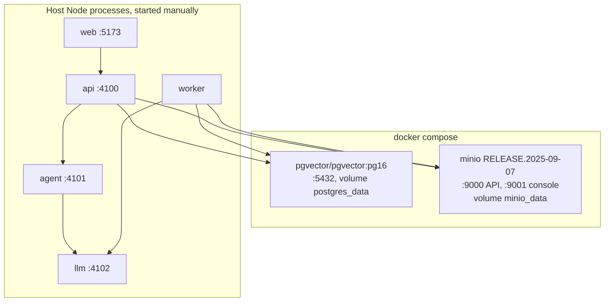
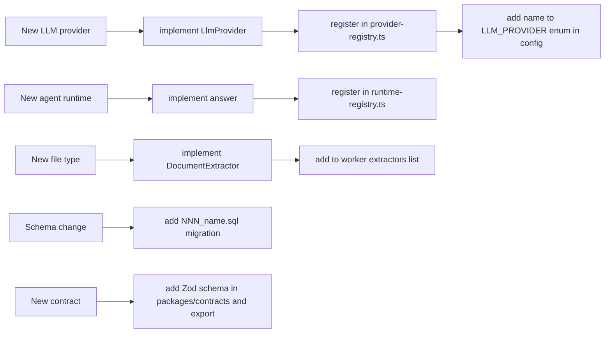
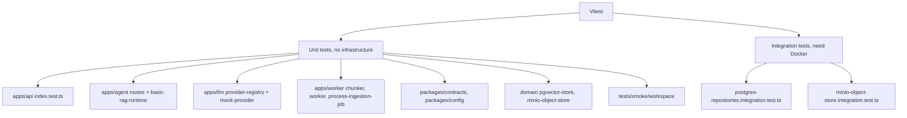

# Development Guide

## Prerequisites
Node.js 20+, pnpm 11+, Docker Desktop (for PostgreSQL/pgvector and MinIO).

## Setup
```powershell
pnpm install
Copy-Item .env.example .env   # then fix AGENT_URL / LLM_URL ports, see configuration.md
docker compose up -d
pnpm typecheck
pnpm build
```

## Running the stack
Each service is a separate process. Per-app `package.json` scripts only define `build`, `test`, `typecheck` (the web app also has `dev`), so build first and start the compiled output, or run the TypeScript entrypoints with your preferred runner:

| Service | Entry | Port |
| --- | --- | --- |
| LLM gateway | `apps/llm/src/index.ts` | 4102 |
| Agent | `apps/agent/src/index.ts` | 4101 |
| API | `apps/api/src/index.ts` | 4100 |
| Worker | `apps/worker/src/index.ts` | – |
| Web | `pnpm --filter @agents-platform/web dev` | 5173 |

Without `DATABASE_URL` the API runs on an in-memory store (no worker/MinIO needed, but nothing is ingested).

### Local deployment



## Commands
| Command | Purpose |
| --- | --- |
| `pnpm typecheck` | Typecheck all projects |
| `pnpm build` | Build packages and the Vite bundle |
| `pnpm test` | Full Vitest run (integration tests need PostgreSQL and MinIO) |
| `pnpm test:integration` | Single-threaded run for Docker-backed tests |
| `pnpm smoke:infra` | Wait for infrastructure readiness (`scripts/wait-for-infrastructure.ts`) |

Docker-free subset: see `README.md` ("Testing"). `*.integration.test.ts` files are Docker-backed; do not count their unavailability as unit failures.

## Conventions
- Strict TypeScript, ESM imports with `.js` suffixes, two-space indent, `kebab-case` files, `PascalCase` classes, `camelCase` functions.
- Keep tenant context explicit; inject dependencies at service boundaries; tests beside implementation, cross-package tests in `tests/`.
- Every tenant-owned feature needs isolation tests; service-boundary tests use injected fakes.
- Before declaring done: `pnpm typecheck`, focused tests, and `pnpm build` if build behaviour changed.

## Extending
- **New LLM provider:** implement `LlmProvider` in `apps/llm/src/providers/`, register it in `provider-registry.ts`, add the name to `LLM_PROVIDER` in `packages/config`.
- **New agent runtime:** implement `answer(AgentRequest): Promise<AgentResponse>`, register in `apps/agent/src/runtime-registry.ts`.
- **New file type:** implement `DocumentExtractor` (`supportedMimeTypes`, `extract`) and add it to the worker's extractor list.
- **Schema change:** add `NNN_name.sql` under `packages/domain/src/migrations`; migrations are forward-only and applied once.
- **New contract:** add the Zod schema to `packages/contracts` and export it from `index.ts`.

### Extension points



### Test layout


