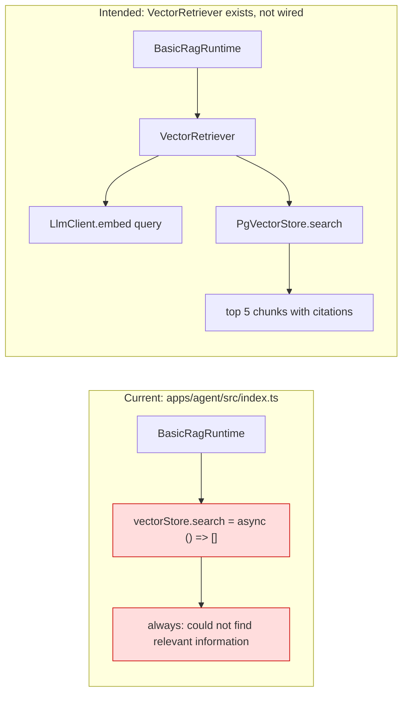

# Known Gaps and Inconsistencies

Observed while reading the code (not exhaustive). These are prototype-stage limitations, listed so they are not mistaken for intended behaviour.

## Functional

> Status 2026-11-12: items 1-4 and the Azure header in item 10 are fixed (see CHANGELOG); the rest remain open.

### Retrieval wiring: current vs intended

1. **Agent retrieval is a stub.** `apps/agent/src/index.ts` passes `vectorStore: { search: async () => [] }`, so `basic-rag` always replies "I could not find relevant information…". `VectorRetriever` (with `PgVectorStore` + `LlmClient`) exists but is not wired in.
2. **Knowledge base / tenant seeding.** The API assigns `knowledgeBaseId: 'default'`, and the web client uses tenant `local`, but the schema requires UUID ids with foreign keys to `tenants` and `knowledge_bases`, and no code creates those rows. The persistent path therefore appears to need seeded data (or code changes) to work end to end.
3. **Conversation history unused.** The API never persists messages through `ConversationRepository.addMessage` and sends `messages: []` to the agent.
4. **Retrieval citations** use `documentId` as `filename`; no page numbers.
5. **Model names hard-coded:** `mock-chat` in `BasicRagRuntime`, `text-embedding-3-small` in embedding clients.
6. **Ingestion robustness:** failed jobs are not retried; jobs stuck in `processing` after a worker crash are not reclaimed; chunk upserts are row-by-row, not batched.
7. **No upload UI, no streaming endpoints, no document delete route** (`VectorStore.deleteDocument` and `ObjectStore.delete` exist but are not called by the API).

## Configuration / contracts
8. `.env.example` ports (3001/3002) differ from code defaults (4101/4102).
9. `@agents-platform/config` `loadConfig` is not used by app entrypoints; `openai` is a declared dependency of `apps/llm` but unused.
10. Azure OpenAI is routed through the generic OpenAI-compatible provider using `Authorization: Bearer`; Azure normally expects an `api-key` header and deployment-scoped URLs.
11. Error bodies are flat `{ code }`, not the `{ error: { code, message, traceId } }` envelope in `contracts/errors.ts`; API request bodies and responses are not validated against the contracts schemas (except the message request).
12. `@agents-platform/observability` is an empty placeholder; only Fastify's default logger and `traceId` fields exist.

## Security
13. `x-tenant-id` is a dev selector, not authentication; there is no authn/authz, rate limiting, request size limit (documents are base64 in JSON), or secret management. Do not expose publicly.
