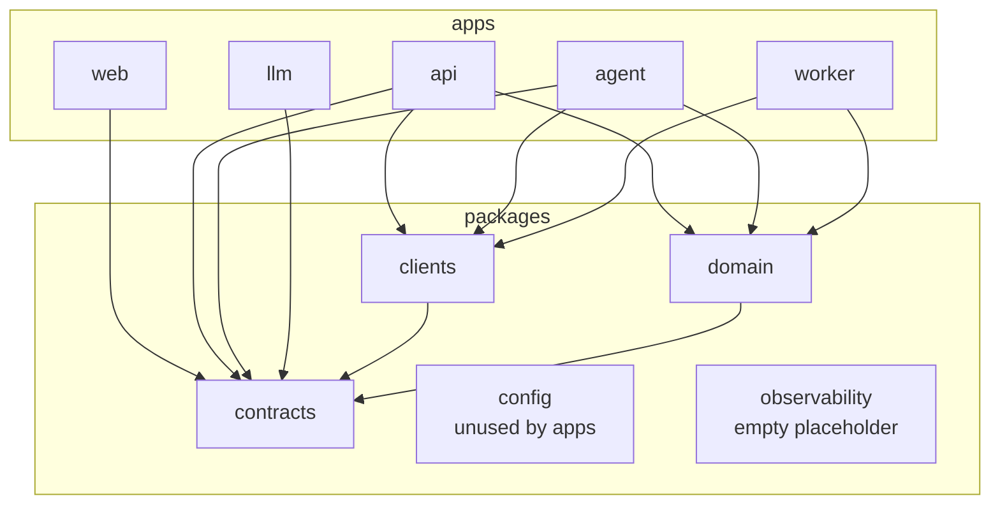
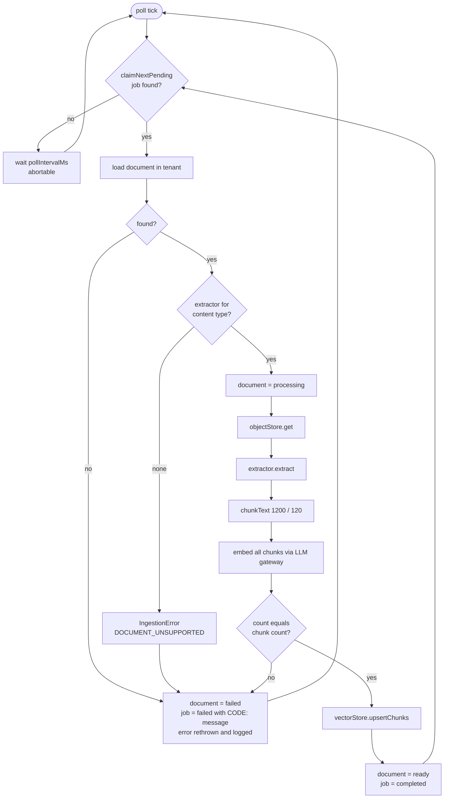
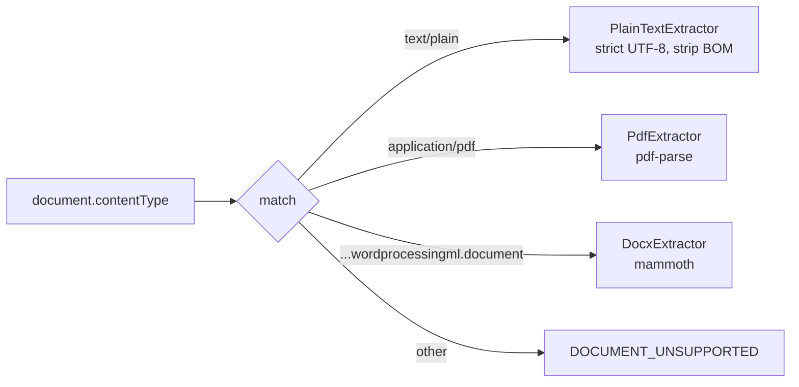
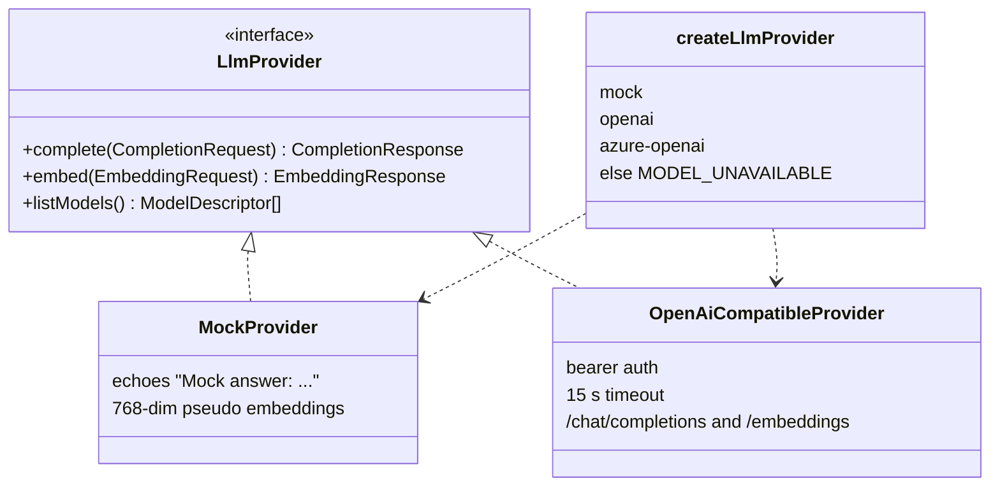
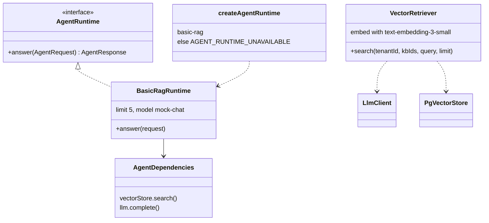

# Services and Packages

### Package dependencies

## Apps

### `apps/api` — public API (Fastify, port 4100)
- `src/index.ts` — `createApp(agent, store)` builds the Fastify app (routes in [api-reference.md](api-reference.md)). `main()` uses `createPersistentApp()` when `DATABASE_URL` is set, otherwise the in-memory store. Skips startup when `NODE_ENV=test`.
- `src/store.ts` — `ApiStore` abstraction with `createMemoryStore()` (dev/test) and `createPersistentStore({documents, conversations, jobs, objectStore})`. The persistent store uploads content to the object store, creates the document row, and enqueues an ingestion job.
- `src/persistent.ts` — composition root: `pg` Pool, `migrate()`, Postgres repositories, `MinioObjectStore`, `AgentClient`; closes the pool on shutdown.

### `apps/agent` — agent runtime service (Fastify, port 4101)
- `src/runtime-registry.ts` — `createAgentRuntime(name, deps)`; only `basic-rag` exists, otherwise throws `AGENT_RUNTIME_UNAVAILABLE`.
- `src/runtimes/basic-rag-runtime.ts` — retrieval (limit 5) + LLM completion (model hard-coded `mock-chat`), citations built from retrieved chunks.
- `src/retrieval/vector-retriever.ts` — embeds a query (`text-embedding-3-small`) and searches `PgVectorStore`.
- `src/http/routes.ts` — `GET /health`, `POST /v1/answer`.

### `apps/llm` — LLM gateway (Fastify, port 4102)
- `src/provider-registry.ts` — `createLlmProvider(config)`: `mock`, or `openai`/`azure-openai` (requires API key and base URL, else `MODEL_CONFIGURATION_INVALID`).
- `src/providers/llm-provider.ts` — `LlmProvider` interface: `complete`, `embed`, `listModels`.
- `src/providers/mock-provider.ts` — deterministic: echoes `Mock answer: <last message>`, produces 768-dim pseudo-embeddings from character codes.
- `src/providers/http-provider.ts` — OpenAI-compatible HTTP client (`/chat/completions`, `/embeddings`), bearer auth, 15 s default timeout → `MODEL_TIMEOUT` / `MODEL_UNAVAILABLE`.
- `src/http/routes.ts` — `GET /health`, `POST /v1/completions`, `POST /v1/embeddings`, `GET /v1/models`.

### `apps/worker` — ingestion worker (no HTTP)
- `src/index.ts` — composition root: migrate, wire repositories/object store/vector store/embedding client/extractors, run until `SIGINT`/`SIGTERM`.
- `src/worker.ts` — `createPollingWorker({jobs, processor})`: `runOnce()` and `run({signal, pollIntervalMs = 1000})`; iteration errors are logged and the loop continues.
- `src/jobs/process-ingestion-job.ts` — the pipeline described in [architecture.md](architecture.md); `IngestionError` codes `DOCUMENT_UNSUPPORTED` / `INGESTION_FAILED`.
- `src/chunking/chunker.ts` — fixed-size character windows with overlap, surrogate-pair safe, deterministic UUID-shaped chunk IDs derived from `documentId:ordinal` (re-ingestion is idempotent).
- `src/extractors/` — `PlainTextExtractor` (strict UTF-8, strips BOM), `PdfExtractor` (`pdf-parse`), `DocxExtractor` (`mammoth`); selected by `supportedMimeTypes`.
- `src/embedding/embedding-client.ts` — `EmbeddingClient` interface; `LlmEmbeddingClient` calls the gateway (`text-embedding-3-small`).

### Worker pipeline

### Extractor selection

### `apps/web` — React 19 + Vite 7 (port 5173)
Single-page "Ask your documents" UI (`src/main.tsx`): creates a conversation, sends the question with `knowledgeBaseIds: ['default']`, shows the answer and citations (`filename · chunkId`). `src/api/client.ts` hard-codes `x-tenant-id: local`. Vite proxies `/v1` to `http://localhost:4100`. No upload UI yet.

## Packages

| Package | Purpose |
| --- | --- |
| `@agents-platform/contracts` | Zod schemas + inferred types: messages, citations, conversation/agent/LLM requests and responses, documents and jobs, usage, error codes, streaming event unions |
| `@agents-platform/domain` | Entities, `TenantContext`, ports, Postgres repositories, `PgVectorStore`, `MinioObjectStore`, `migrate()`, SQL migrations |
| `@agents-platform/clients` | `AgentClient.answer`, `LlmClient.complete/embed/listModels` (thin `fetch` wrappers; non-2xx → `AGENT_UNAVAILABLE` / `MODEL_UNAVAILABLE`) |
| `@agents-platform/config` | `loadConfig(env)`: Zod-validated `AppConfig`, requires provider secrets for non-mock providers |
| `@agents-platform/observability` | Placeholder — only a `package.json`, no source yet |

`migrate(pool)` applies `NNN_name.sql` files in order inside one transaction guarded by `pg_advisory_xact_lock`, recording them in `schema_migrations`.

### LLM provider classes

### Agent runtime classes

